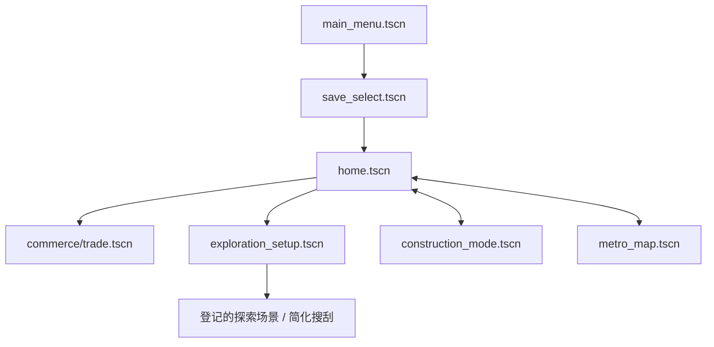

# 工程结构与调整指南

本文说明模块职责和代码调整位置。玩法见 [游戏 README](README.md)，内容编辑操作统一见 [编辑器 README](../tools/editors/README.md)，探索的完整事件流见 [探索架构](EXPLORATION_ARCHITECTURE.md)。以下资源路径相对于 Game，即 Godot 的 `res://`。

## 文件结构

```text
Game/
├─ project.godot                 工程、自动加载及主场景设置
├─ export_presets.cfg            导出设置，包含 content JSON
├─ scenes/
│  ├─ ui/                       主菜单、三栏位存档、设置
│  ├─ game/                     Home、车厢分层、整备、探索、早期原型
│  ├─ construction/             独立装修场景
│  ├─ map/                      独立线路图与新闻场景
│  ├─ commerce/                 交易及客户窗口
│  ├─ exploration/stations/     编辑器生成的站点探索场景
│  └─ items/                    通用家具和高亮场景
├─ scripts/                     下表中的控制器与规则
├─ content/                     客户、站点列表、地图定义与场景登记
├─ resources/                   家具与物品的 .tres 定义
├─ assets/
│  ├─ source/                   Aseprite、客户原图与生成记录
│  ├─ textures/                 运行时 PNG，客户每位独立保存
│  ├─ maps/                     地图背景及编辑器上传素材
│  ├─ shaders/                  描边及地表照明
│  └─ icons/                    图标
├─ addons/godot_ai/             第三方插件，保留内部依赖
├─ addons/metro_content_editor/ 独立桌面编辑器启动器（可选自动启动）
└─ saves/legacy_demo/           旧调试存档归档
```

`assets/source/.gdignore` 阻止源文件自动导入；运行时使用 textures。`.uid` 和 `.import` 是资源标识/导入配置，不作为重复文件删除。`.godot/` 是可重新生成的本机缓存。

## 脚本职责

| 文件或模块 | 职责 |
| --- | --- |
| `core/game_session.gd` | 自动加载会话、三个存档栏位、命名基地与旧单存档入口 |
| `ui/main_menu.gd`、`ui/save_select.gd`、`ui/settings_panel.gd` | 主菜单、存档 UI、音量与全屏设置 |
| `home.gd` | 共享状态、Home 页面调度、探索协调、背包/装备界面 |
| `cabin_state.gd` | 车厢经济、生存、物品、家具布局、探索与存档规则 |
| `cabin_map.gd`、`cabin_markets.gd` | 地铁路线、站点设施、供需和报价 |
| `ui/ui_builder.gd` | 动态界面通用控件与样式 |
| `ui/home_backdrop.gd` | 背景/车厢分层、家具视图、视角拖动与回中 |
| `items/item_catalog.gd` | 读取物品JSON并实例化所有 MetroItem，供背包和交易使用 |
| `exploration/player_motion.gd`、`enemy.gd` | 体力/跑步/噪声与敌人行为、警觉、扑击 |
| `exploration/loot_table.gd`、`container_panel.gd` | 建筑加权物资与柜子领取窗口 |
| `items/item_definition.gd` | MetroItem Resource：物品 ID、尺寸、贴图与家具对应 |
| `items/furniture_definition.gd`、`furniture_catalog.gd` | 家具资源字段、占格、挂点、默认布局与迁移 |
| `items/furniture.gd`、`highlightable_item.gd` | 家具行为、透明像素命中、统一描边和功能提示 |
| `construction/construction_mode.gd` | 统一装修输入、选择、拖动、拆除、仓库与扩建 |
| `construction/hold_progress.gd`、`placement_grid.gd`、`placement_preview.gd` | 蓄力圈、可摆放网格和有效/无效预览 |
| `cargo_grid.gd` | 背包/柜子网格、拖放、旋转与选中预览 |
| `map/metro_map.gd` | 新闻、线路图、目的地详情、站点查询和行车 |
| `commerce/trade.gd` | 交易页面、拖拽清单、确认/送客、交易对话 UI |
| `commerce/customer_orders.gd` | 订单、每日名额和去重、预算、库存及原子结算 |
| `commerce/customer_catalog.gd`、`customer_window.gd` | 读取角色定义、即时加载头像、上半身裁取和进退动画 |
| `commerce/customer_dialogue.gd` | 条件、优先级、节点、效果去重、关系与跨日事件 |
| `commerce/trade_drag_item.gd`、`order_drop_zone.gd` | 原生商品拖放与订单接收区域 |
| `content/exploration_building.gd` | 建筑实例类，封装门、楼梯和占用边界几何 |
| `commerce/meeting_dialogue.gd` | 封装一次见面中的 NPC 轮次和玩家回答，供交易/探索共用 |
| `content/network_catalog.gd` | 双层线路图 JSON 的运行时读取；坐标转换与图层数据 |
| `content/content_registry.gd` | JSON 读取、站点到关卡和场景的映射 |
| `content/npc_interaction.gd`、`preview_level.gd` | 探索 NPC 对话窗口、隔离的关卡预览会话 |
| `ui/exploration_setup.gd`、`exploration.gd` | 整备界面和探索场景接线 |
| `surface_block.gd`、`surface_minimap.gd` | 街区世界、交互/绘制和拓扑小地图 |
| `auto_repair.gd` | 汽修培训等级、费用和可拆零件 |
| `main.gd`、`world.gd`、`player.gd`、`state.gd` | 早期横版原型；state 仍是 cabin_state 的基类 |

## 场景与共享状态



Home 持有同一个 cabin_state 对象。交易、整备和探索由 Home 加载为页面；装修和线路图是与 Home 同级的独立场景，进入时隐藏并停用来源场景，返回时恢复。装修只提供自身按钮，不继承 Home 工具栏，也不提供线路图入口。

`SettingsButton` 是 `home.tscn` 的直接子节点，连接 `Home.show_settings()`。`begin_page()` 将动态页面插在该按钮之前，保持绘制和 GUI 命中顺序一致。装修中 World 在工具栏/面板之前，刷新只重建 World 内容。GUI 点击顺序依控件树和 mouse_filter 管理，不能仅靠 z_index。

设置面板为 `scenes/ui/settings_panel.tscn`，使用 CanvasLayer 遮罩拦截下方点击。音量、全屏立即写入 `user://settings.cfg`；游戏内设置暂停移动、耗电和计时，关闭时补偿真实经过时间。

## 电脑、新闻与线路图

电脑的 news 动作进入 `map/metro_map.gd → show_news()`，先创建线路图，再叠加 NewsCard；关闭新闻恢复地图。线路图左侧 NetworkMapPanel/RailMap 绘制地铁线路和站点，右侧 StationDetails 显示站内报价或站外情报及前往按钮。

| 调整内容 | 位置（1280×720逻辑坐标） |
| --- | --- |
| 新闻卡片 | `map/metro_map.gd → show_news()`，默认 `(318,173,644,372)` |
| 新闻正文与天气 | `cabin_state.gd → news()/weather()` |
| 地图左右分栏 | `map/metro_map.gd → show_map()`，左 `(40,89,865,585)`，右 `(923,89,317,585)` |
| 站内报价 UI | `show_map_market()/map_quote_column()` |
| 目的地与前往 | `select_station()/set_map_tab()/travel()` |
| 站点设施与供需 | `cabin_markets.gd` |
| 路线、站点坐标与情报 | `content/network_map.json` 编辑几何与连接；`cabin_map.gd` 负责运行时绘图和情报 |

屏幕家具 `action=none`，显示站名、日期、天气并提供悬浮提示；电脑承担线路图入口。

## 车厢、家具与装修

```text
HomeBackdrop
├─ Background                  BG_Afternoon，后层视差
└─ Carriage                    整列车的变换父节点
   ├─ Texture / Carriage2 / Carriage3
   ├─ Fixtures                 固定交易窗，复用高亮
   ├─ FurnitureGrid / FurnitureSlots / FloorPreview
   └─ HangingFixtures          前景挂点、屏幕与放置预览
```

`items/furniture_catalog.gd` 集中定义每节35×12地面格、四个4×3栏杆挂点及默认位置。格子约27.31×27.31逻辑像素，从内壁 `(162,196)` 开始，宽956、高约327.77，覆盖天花板下沿至地板上沿。挂点不占地面格，显示和命中在地面家具前景。

| 家具资源 | 家具占格 | 特殊规则 |
| --- | --- | --- |
| `resources/furniture/computer.tres` | 3×2 | fill_grid=false，保持比例居中；储物尺寸另为2×2 |
| `locker.tres` | 3×12 | 地面 |
| `door.tres` | 8×12 | 地面 |
| `bed.tres` | 8×2 | 地面 |
| `screen.tres` | 4×3 | 仅栏杆挂点 |

`ConstructionMode` 统一处理所有家具。长按阈值1秒；未蓄满且移动超过8像素会取消蓄力。预览与提交共用 `cabin_state.gd → furniture_placement_problem()` 检查类型、边界、车厢及重叠。HoldProgress 不拦截输入；拖动物品期间锁定视角。

`resources/items/computer.tres` 定义可收纳电脑。摆放消耗一个背包/柜子条目，恢复底面朝下；移动现有家具不消耗物品。拆除返还未旋转物品，空间不足时保留家具。其他家具使用家具仓库的收纳状态。

`highlightable_item.gd` 使用透明像素命中，`assets/shaders/item_outline.gdshader` 用八方向 alpha 膨胀生成白描边，并补两像素纹理边距。功能提示仅由该模块显示，原生 tooltip_text 留空。

源图在 source，运行图在 textures；家具资源 source_origin 保留裁剪偏移。导出、裁剪和生成操作统一见 [工具索引](../tools/README.md)。背景拖动上限为视口10%，回中速度320逻辑像素/秒；多车厢回到松手时最靠近视口中心的一节，距离相同保持原焦点。

扩建参数由 cabin_state 定义：最多3节，每次钢板2、螺丝4、工具1；每增加一节行车/接应+10度/站、日结+2度，新增相同网格和挂点。

## 交易、NPC 与内容数据

```text
Home/Trade
├─ Panel
│  ├─ CustomerWindow           独立窗口和客户动画
│  ├─ Bag / Stock / Basket     拖放来源和待确认清单
│  ├─ Confirm / Dismiss        确认交易、送客
│  └─ Order / Quote / Account / Status / Map / Close
└─ DialogueOverlay            优先剧情与分支
```

HomeBackdrop 仍使用原窗户热点，不显示客户。客户窗口448×360，AtlasTexture 从独立48×80图片裁取上方48×44；入场等待后，成交或送客触发向右离场，结束才生成下一张订单。新客户入场时重新读取目录与贴图，避免静态头像缓存漏掉新增角色。

订单以顾客方向区分 buy/sell。拖放只调整清单，确认时完整校验类别、唯一物品、库存、背包空间和预算后一次提交；送客不结算。customer_visits 保存各站 arrived/completed/dismissed/active，daily_customer_ids 跨站记录当日已来访身份。

`customer_dialogue.gd` 同时服务交易和探索。故事 contexts 决定互动入口，after 记录前置 NPC/故事与间隔天数；条件可读取资金、物品、标记、好感、阵营信任及事件完成记录。节点/选项效果用会面、故事、节点/选项凭据去重，避免读档重复累加。

| 数据文件 | 职责 |
| --- | --- |
| `content/items.json`、`enemies.json` | 物品定义及怪物素材/碰撞/行动/警觉/攻击参数 |
| `content/building_templates.json` | 可在各站拖入复用的建筑素材类定义 |
| `content/customers.json` | 稳定角色目录、独立贴图、预算、权重、阵营与剧情 |
| `content/stations.json` | 内容编辑器可选的地铁站列表 |
| `content/registry.json` | 站点到关卡 JSON 及 tscn 的映射 |
| `content/levels/postal.json` | 邮电街区默认定义和编辑模板 |
| `content/levels/station_<hash>.json` | 独立站点地图；包含街道起点、建筑柜子、汽车、NPC及怪物位置 |
| `scenes/exploration/stations/station_<hash>.tscn` | 编辑器生成的基础探索场景实例 |

`content_registry.gd` 读取映射，Home 加载对应场景，SurfaceBlock.apply_level() 将 JSON 转为实例数据；绘图、交互和小地图共用同一数据。各街道长度独立，移动边界按当前街道限制，小地图不生成缺失格子的连接。未登记站点继续简化搜刮。作者操作与接口参数见 [编辑器 README](../tools/editors/README.md)。

## 存档与验证

当前版本17额外保存8×6预备仓库，版本16起保存主动位、家具布局 `{car,x,y}`（挂点另有 mount）、独立储物物品与朝向、订单、剧情进度、关系与事件。兼容1～16版（旧存档迁移时在预备仓库补入四件实体工具），加载先验证再更新状态；家具迁移保留车厢/收纳/挂点，冲突时按旧版规则就近安放。

主菜单存档和设置路径见 [游戏 README](README.md#存档与设置)，关系与来访记录的迁移边界见 [编辑器 README](../tools/editors/README.md#7-存档与生效时机)。测试分组、命令与日志统一见 [test/README.md](../test/README.md)。

地铁总地图统一存储在 `content/network_map.json`：线路层为站点/折点/线路连接，贴图层为地图素材、坐标、尺寸、旋转及透明度。`cabin_map.gd` 不再保存站点及线路坐标常量，游戏重新打开地图时刷新数据，线路变化同时影响路径计算。编辑器与 Godot 启动入口见 [编辑器 README](../tools/editors/README.md)。

`addons/metro_content_editor/plugin.gd` 只调用 Godot 自带的启动、项目偏好、HTTP 和资源刷新接口；`project_link.gd` 负责发现编辑器位置。独立程序入口为 `tools/editors/desktop.py`，Qt 提供原生窗口、菜单、文件选择、关闭确认和单实例锁，完整编辑界面及业务校验复用现有文件。双向路径集中由 `server.register_project()` 保存；不维护第二套 Godot 原生编辑 UI。
