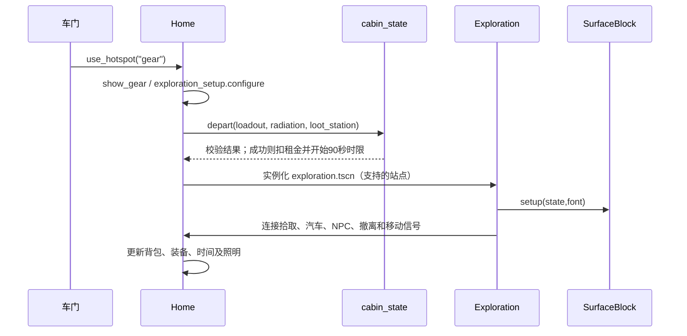

# 探索模块详细架构

本文对应当前 `home.tscn → exploration_setup.tscn → exploration.tscn` 流程。探索由 Home 加载并复用其状态对象；线路图是同级独立场景。地图编辑与 NPC 剧情操作见 [编辑器 README](../tools/editors/README.md)，本文集中说明运行时数据流。

## 1. 分工与依赖

| 文件 | 当前职责 | 调整入口 |
| --- | --- | --- |
| `scripts/home.gd` | 页面切换、整备选择、出发/撤离、输入桥接、背包和装备 UI、汽车面板、超时及设置暂停 | `confirm_departure`、`show_surface`、`update_surface_pack`、`check_trip_timeout` |
| `scripts/cabin_state.gd` | 背包/电池/租金/欠费/车电、探索时限、战利品与领取记录、拆车规则、存档 | `depart`、`roll_loot`、`pick_up_ground`、`salvage_vehicle_part`、`extract_at`、`fail_trip` |
| `scenes/game/exploration_setup.tscn` + `scripts/ui/exploration_setup.gd` | 整备页面壳和动态控件：防护服、撬棍、扳手、背包、电池 | `panel_bounds`、`configure(home,message)` |
| `scenes/game/exploration.tscn` + `scripts/exploration.gd` | 页面布局和信号接线；把场景中的标签、街区、背包锚点交给 Home | 场景 Control 布局、`configure(home)` |
| `scripts/surface_block.gd` | 街区数据、人物位置、建筑/楼层/巷道切换、可交互目标、镜头、程序绘图与室内光照 | `BUILDINGS`、`LOOT`、`VEHICLES`、`JUNCTIONS`、`interaction`、`_draw` |
| `scripts/content/content_registry.gd` | 读取站点登记和地图 JSON | `entry/level/scene` |
| `scripts/content/npc_interaction.gd` | 探索 NPC 对话窗口，调用共用关系与事件模型 | `setup/show_node/advance` |
| `scripts/commerce/customer_dialogue.gd` | 条件、好感、阵营信任、跨日事件和效果去重 | `pending/enter/finish/apply_effects` |
| `scripts/surface_minimap.gd` | 从街区读取位置、已访问格及连接关系，绘制小地图 | `setup`、`update_location`、`_draw` |
| `scripts/cargo_grid.gd` | 共用网格控件：命中、物品图标、拖放/旋转预览 | `setup`、`_get_drag_data`、`_drop_data` |
| `scripts/auto_repair.gd` | 同济大学汽修等级、费用、各级可拆零件 | `COURSES`、`required_level` |
| `assets/shaders/surface_light.gdshader` | 室内暗幕与朝向手电光 | `lamp_position`、`facing`、`lamp_on` 参数 |
| `scripts/cabin_map.gd` | 地铁站辐射数据、站间路线，决定撤离接应车电 | `station_info`、`route` |

这里不是完整 MVC：规则已集中在 State，但 Home 仍同时承担页面、装备 UI 和探索协调。`exploration.gd` 是轻量接线层，`surface_block.gd` 则同时承担世界数据、交互和绘图。

## 2. 场景树与布局

```text
Home
├─ SettingsButton                         始终属于 Home
└─ Exploration (exploration.tscn)
   ├─ Background
   ├─ Location / Departure / Timer         地点、出发站与车电、剩余时间
   ├─ StreetFrame (clip_contents=true)     左侧777×524的裁切视窗
   │  └─ SurfaceBlock                     地表世界 Control
   │     └─ InteriorLight                 setup 时创建的室内暗幕
   ├─ Minimap                             根据地图行列数自适应的小地图
   ├─ InteractionPrompt                   当前唯一 E 交互提示
   ├─ PackAnchor                          右侧404×524区域
   │  └─ 动态背包/装备/电池槽/扳手按钮
   ├─ Status                              底部结果和错误提示
   ├─ VehicleParts                        检查汽车时由 Home 动态创建
   └─ NPC 对话窗口                         npc_interaction.gd 动态创建
```

页面按1280×720逻辑坐标布局。`exploration.tscn` 负责外部框架；背包的内部格子和装备按钮由 `Home.update_surface_pack()` 绘制，不能仅改 PackAnchor 就改变内部所有间距。默认移动背包格为48像素，电池槽52像素。

## 3. 整备到进入街区



整备字典包含 `heavy/wide/light/crowbar/wrench`。State 校验已安装电池有电、必带手电、高辐射时使用加强防护服、背包边界合法，以及没有正在进行的探索。普通防护服租金30度、加强50度，走账户/欠费规则；与车厢电源余额分开。成功后设置装备、物资槽、出发站、真实时间截止点。

可行走街区由 `content/registry.json` 登记，Home 根据站点加载指定场景和地图 JSON。邮电新村、四平路、同济大学默认共用 `content/levels/postal.json`，从对应站口进入，并使用共同的 loot_station。五角场已有独立登记，后续可由编辑器继续扩展；未登记站点走 `Home.show_legacy_surface()` 简化搜刮。

## 4. 世界数据与位置

`SurfaceBlock` 不是 TileMap 或 CharacterBody2D：它是一个 Control，地图、车辆和玩家主要通过 `_draw()` 绘制，没有为每栋楼、每件物资创建独立物理节点。

- 世界宽为 `segment × cell_names[0].size()`，邮电模板默认3段×560＝1680像素。编辑器支持1～8条街道、每条1～8格。
- `row` 是从0开始的街道索引，邮电模板前三条为北/中/南；`player_x` 为当前街道水平位置。
- 小地图列由 `floor(player_x / segment)` 推导，显示当前地图拓扑并自适应间距；与地表像素、家具网格分别计量。
- `building` 空字符串表示街上，非空表示当前建筑ID；`floor_index` 表示楼层0/1。
- 邮电模板含9栋建筑、4辆车、10个物资点、3个撤离口；实际数量由当前地图定义。
- `apply_level()` 把 JSON 转为 `BUILDINGS/LOOT/VEHICLES/JUNCTIONS/STATIONS/NPCS` 等实例字段，`DEFAULT_*` 常量仅作回退值。
- `JUNCTIONS` 指定横坐标处的巷口，连接相邻街道；切街时保留巷口横坐标。
- `visited` 记录已访问的小地图格；`fares` 缓存各站接应车电报价。

A/D或左右键改变 `player_x`，速度235像素/秒；街上边界为世界两端，进入建筑后限制在建筑内部。检查汽车、NPC 对话、拖放背包或探索未开始时不处理行走。楼层切换和穿巷是位置状态变更，不是跳跃/物理攀爬。

## 5. 输入、交互与事件

Home 把 E 键转给 `SurfaceBlock.interact()`，把1键转给手电开关。`interaction()` 每次只返回一个动作，优先级为：

1. 室外附近 NPC（对话中不返回新交互）；
2. 可拾取物资；
3. 室内楼梯、室内出口；
4. 地铁撤离口；
5. 街道巷口；
6. 建筑入口；
7. 附近汽车。

交互距离默认43像素。物资还要求街道、建筑ID、楼层匹配；室内未开手电时不能拾取。`interact()` 对穿巷、进出建筑和楼梯直接更改世界位置，随后 `position_changed()` 刷新访问记录、照明和图形，并发出 `moved`。

| 世界信号 | 接收回调 | 规则/界面效果 |
| --- | --- | --- |
| `pickup_requested(slot)` | `pick_up_surface_item` | 再次校验超时、距离、背包容量，成功后领取槽位并刷新背包 |
| `extraction_requested(station)` | `extract_from_block` | State 检查路线和车电，扣接应耗电，改变车厢所在站，结束探索并回 Home |
| `vehicle_requested(id)` | `show_vehicle` | 暂停行走，创建零件面板；要求汽修等级和装备扳手 |
| `npc_requested(id)` | `Exploration.show_npc` | 创建 NPC 对话窗口，共用 customer_dialogue 模型；阻止行走，时限继续 |
| `moved` | `update_surface_position` | 更新地名、楼层、E提示，失去拾取距离时取消地面选择 |

背包拖放通过 CargoGrid 发出 Home 的选中/移动请求，再由 State 执行边界、重叠和朝向校验。R/滚轮旋转、右键/Esc取消；不是直接在绘图层里修改库存。刷新背包会重新生成侧栏，**保留 SurfaceBlock 实例**，因此人物位置、楼层和已访问格不会因整理背包重置。

## 6. 物资、汽车与电池

`roll_loot()` 根据辐射、撬棍和站点随机种子生成当前探索的物资种类；`LOOT` 定义槽位位置，并可通过 kind 覆盖指定掉落。Home 为新增物资点补足战利品数组，再应用固定 kind。State 的 `collected` 标记已领取槽位，背包放不下时不会先删地面物资。

自定义地图汽车 ID 自动加关卡前缀，避免不同关卡拆解记录冲突。汽车使用唯一ID，与 `AutoRepair.COURSES` 的等级及零件表连接。Home 显示可拆项，State 校验扳手是否装备、等级、是否已拆、背包空间，成功后加入库存。汽车检查面板可关闭，不重建街区。

手电使用独立安装的七号电池，基础耗电5%/秒；满电持续开启约20秒，不等于90秒探索时限。备用电池和安装槽之间通过共用物品规则移动。室内手电既改变可拾取判断，也驱动暗幕着色器；关灯后并非只把画面变暗，拾取规则也会改变。

## 7. 镜头、绘图与小地图

`camera_offset()` 让玩家水平居中并夹在世界边界。`_draw()` 依次绘制天空与远景、上一条街道的缩放视差、当前街道地面、巷口、建筑/室内、车站、车辆、物资、NPC 贴图及玩家。人物步态用 `pace` 的正弦变化绘制双腿；目前探索玩家仍是程序画出的角色，NPC 的独立 PNG 不会替代该玩家。

进入建筑时 `draw_interior()` 绘制楼板、家具及楼梯；`InteriorLight` 暗幕按建筑范围布置，光源位置由玩家位置、楼层和朝向换算。

小地图通过 `map_connections()` 获取横向道路与巷道连接，监听 `moved`；当前格、已访问格和未访问格使用不同颜色，当前地图的撤离站单独标注。它只读街区，不独立拥有探索状态，也不决定实际道路可达性。

## 8. 撤离、超时与保存

探索截止点以 `Time.get_ticks_msec()` 计时，基础90秒。Home 每帧更新倒计时和手电；超时会走 `fail_trip()`，丢失背包物品及安装电池，并收取普通防护服300度/加强500度赔偿，不足走欠费规则，随后回车厢。

从当前站撤离不产生跨站接应路费；其他站按地铁路线站数×当前每站车电（随车厢扩建增加）计费。车电不足时保留探索状态并提示错误，不提前结束。

设置暂停 SceneTree；关闭设置时把真实经过时间补回截止点，防止菜单里时间仍被扣完。检查汽车或 NPC 对话不会暂停整个探索时限，只阻止人物移动。当前探索不是中途自动保存点；正常保存仍走车厢床铺结算/现有存档流程。

## 9. 常见修改位置

| 目标 | 修改位置 |
| --- | --- |
| 地表视窗、侧栏、小地图和文字的位置 | `scenes/game/exploration.tscn` |
| 整备界面尺寸和选项布局 | `scripts/ui/exploration_setup.gd` |
| 行走速度、交互距离 | `surface_block.gd` 的 `SPEED/REACH` |
| 街道宽度、行列及 NPC 位置 | `content/levels/*.json` 的 segment/cell_names/npcs |
| 建筑、巷口和车站位置 | 关卡 JSON；入口/楼梯算法在 `door_x/stair_x` |
| 物资出现位置与室内拾取条件 | 关卡 loot 数据、`can_take()` |
| 掉落种类、稀有概率和领取记录 | `cabin_state.gd` 的 `roll_loot/pick_up_ground` |
| 背包大小、占格、旋转和重叠校验 | `cabin_state.gd`、`cargo_grid.gd` |
| 手电耗电、探索时限、租金与超时赔偿 | `cabin_state.gd` 的相关常量及 `depart/fail_trip` |
| 车辆职业技能及零件 | `auto_repair.gd`、`cabin_state.gd` |
| 未来独立角色贴图或建筑美术 | `surface_block.gd` 的 `draw_player/draw_facade/draw_interior` |

使用编辑器保存关卡时，工具会验证边界、对象引用并生成站点场景与登记。NPC 对话内容在客户/NPC 编辑器维护，地图仅引用角色 ID 和位置；游戏重新进入探索后读取新定义。手改 JSON 时也应保持建筑、物资、巷口与 NPC 引用一致。
